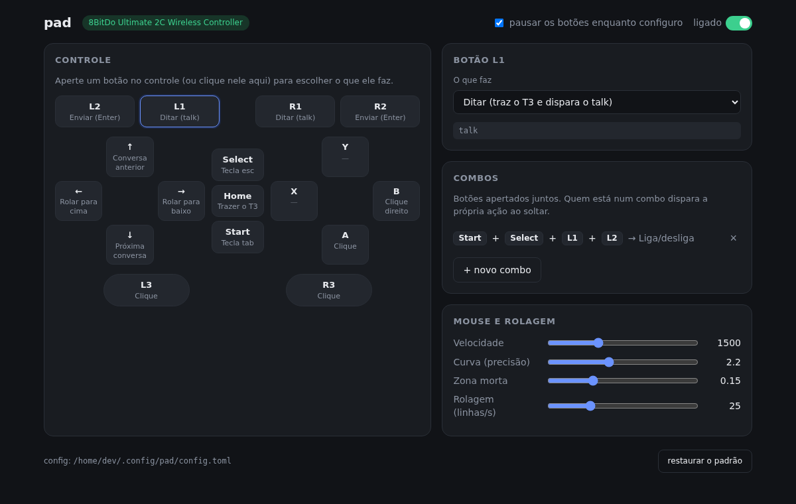

# pad

O controle (8BitDo no modo X, ou qualquer controle de Xbox) como controle
remoto do T3 Code, no Linux com COSMIC. Leve: uma thread lendo o controle,
~2 MB de RAM, CPU parada quando os analógicos estão parados.

- **L1 / R1**: traz o T3 para a frente (mesmo minimizado) e dispara o ditado
  do talk na caixinha onde você estava.
- **L3** (apertar o analógico): dita onde está o mouse. Clica ali (a caixa
  ganha o foco) e dispara o talk; ao parar, clica de novo e o texto cai onde o
  mouse estiver.
- **L2 / R2**: Enter. **Direcional ↑ ↓**: conversa anterior/próxima;
  **← →**: rolar para cima/baixo (segure para continuar).
- **Os dois analógicos**: mouse.
- **Vibra quando o T3 precisa de você**: uma resposta terminou (2 tremidas) ou
  ele perguntou algo e espera (3). Liga/desliga pela bandeja; força, duração e
  quantas tremidas na tela de ajustes (`[notify]` no config).
- **Start + Select + L1 + L2**: liga/desliga o pad (vibra 1x ligado, 2x desligado).

## Ajustes

Clique no ícone do controle na bandeja (ou rode `pad ui`): abre
<http://127.0.0.1:7477>. Aperte um botão no controle e ele fica marcado; escolha
o que ele faz (os comandos do T3 vêm com nome, lidos dos atalhos do próprio T3).
Também dá para gravar combos apertando os botões juntos e ajustar o mouse.
Com a tela em foco, os botões só aparecem nela e não disparam nada.



Tudo fica em `~/.config/pad/config.toml` (criado na primeira vez, com um
comentário em cada chave), que também dá para editar à mão. Salvou, valeu: o
pad relê sozinho. A tela grava sem apagar os comentários.

## Instalar

Sem o código (baixa o binário da última release, x86_64):

```sh
curl -fsSL https://raw.githubusercontent.com/fioravante-dev/pad/main/install.sh | sh
```

De dentro do código, `./install.sh` compila em vez de baixar. Os dois põem o
pad em `~/.local/bin/pad`, criam o serviço `pad` do systemd do usuário (sobe
com a sessão gráfica e volta sozinho se cair) e um atalho "pad" no menu de
aplicativos, que abre os ajustes.

```sh
systemctl --user status pad      # rodando?
systemctl --user restart pad
pad check                        # confere o config.toml
tail -f ~/.cache/pad/pad.log
```

Precisa da sessão gráfica (WAYLAND_DISPLAY) e de acesso a `/dev/uinput` e ao
controle; o logind dá os dois para quem está logado na frente do PC.
